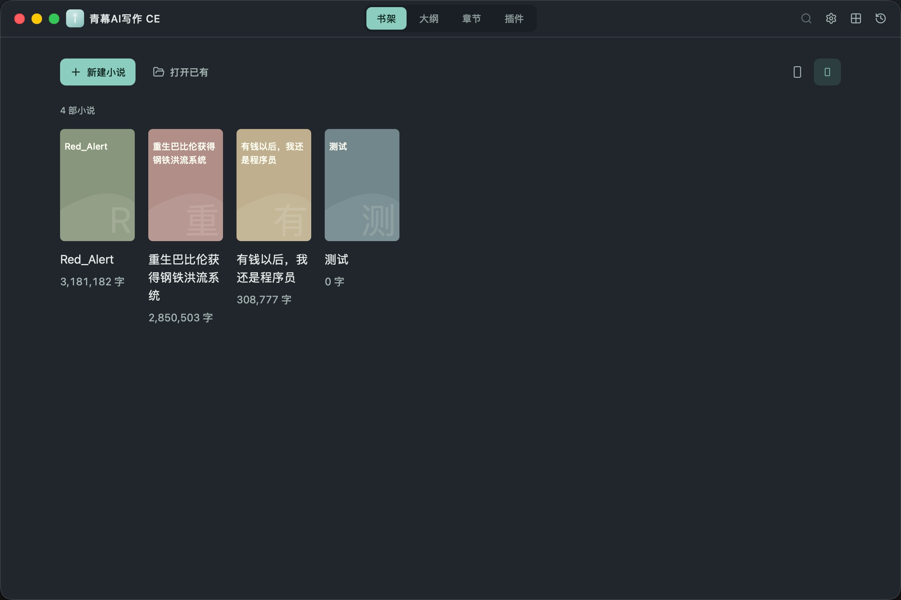

<p align="center">
  
</p>

<h1 align="center">青幕AI写作 CE</h1>
<p align="center">
  长篇写过几百章，仍能循着原文，接上第一卷埋下的伏笔。
</p>

<p align="center">
  <a href="https://github.com/darknessomi/QMAI-CE/releases">
    
  </a>
  <a href="https://github.com/darknessomi/QMAI-CE/releases/latest">
    
  </a>
  
  <a href="LICENSE"></a>
</p>

青幕是为百万字连载设计的开源桌面写作工具。隔了一卷再写两个人重逢，当年那句承诺究竟是怎么说的？青幕为本地书稿建立全文索引。续写时，它把本章章纲、人物记忆和相关的前文原句放在一起，让你熟悉的 AI 有据可依，让你随时能翻回那一章核对。

你可以自己写，也可以让 AI 先起草，留下合心意的段落，再按自己的笔调往下写。书稿以 Markdown 保存在本机。

## 用你已经在用的 AI 写小说

| 工具 | 命令 |
| --- | --- |
| Claude Code | `claude` |
| Codex CLI | `codex` |
| Cursor CLI | `cursor-agent` |
| Antigravity CLI | `agy` |

只要电脑上装好并登录了其中任意一款，就能在青幕里直接让它帮你写。故事往哪走由你拿主意，青幕负责把本章章纲和相关前文交给选中的工具。写完想换另一个 AI 来审稿，面对的依然是同一部书，省去了来回复制大纲和正文的折腾。

**用自己的模型。** 青幕也支持直连 OpenAI、Anthropic、Google Gemini、DeepSeek、Kimi、智谱 GLM 等模型服务，兼容 OpenAI 接口，也可通过 Ollama 在本机运行模型。

**在熟悉的 Agent 里继续写。** 通过 MCP，你可以直接告诉外部 Agent「按章纲写第十二章，保存为草稿」。它能调用青幕的写作流程、查看进度，再把草稿存回书稿。



## 长篇写到后半，也接得住前文

交出钥匙那一晚，他还叫「阿九」。几十章后再出场，人人都喊他「九叔」。当年钥匙究竟交到了谁手里？青幕用 SAG2 检索配合 JEV，能顺着人名与旧称翻回当初那几行正文，连同出处一并带进续写。即便回头修订旧章，引用的历史依据也只取自那一章之前、允许 AI 读取的定稿。

读者亲眼见过那次交接，追查钥匙的人却不在场——他凭什么一开口就咬定是九叔？青幕把人物当下的见闻和读者已知的线索分开记录。审稿时可以对照前文，判断这里是漏写了一场戏，还是某句对白说早了。

<details>
<summary>查看 SAG2 的索引开销、续写耗时与证据召回率</summary>

**索引开销。** 上游 QMAI 启用向量检索时，每次改动段落都要重新计算向量。青幕 CE 直接更新本地全文索引，建索引的模型调用为零。SAG2 团队在 M4 Pro 上为 11,656 个段落建索引，用时 2.36 秒。[SAG2 论文 · 表 12：索引构建耗时](https://arxiv.org/html/2610.22588v2#A5.T12)

**普通续写耗时。** 青幕在 macOS 上用一部 26 章中文小说做了一次测试。检索用时 6.41 秒，5 段带出处的原文进入了续写提示词。[QMAI-CE PR #3 · macOS 普通写作验证](https://github.com/darknessomi/QMAI-CE/pull/3)

**证据召回率。** 下表引自 SAG2 团队的公开评测，每个数据集各取 1,000 题。Recall@10 衡量每题所需的证据有多少出现在前十条结果里，再对所有题目取平均。青幕新旧版本在同一批中文小说问题上的差值仍待实测。[SAG2 论文 · 表 1：多跳检索召回率](https://arxiv.org/html/2610.22588v2#S4.T1) · [SAG-Wiki 评测说明](https://github.com/Zleap-AI/SAG-Wiki/blob/b6940ac834b3b1ec651c0b49dc1b0c45d4d74c4a/README-CN.md#technology)

| 数据集 | BGE-Large-EN-v1.5 向量检索 | NV-Embed-v2 向量检索 | SAG2 + JEV | 较 NV-Embed-v2 提高 |
| --- | ---: | ---: | ---: | ---: |
| MuSiQue | 64.08% | 77.27% | **86.62%** | 9.35 个百分点 |
| 2WikiMultiHopQA | 73.75% | 80.75% | **97.43%** | 16.68 个百分点 |
| HotpotQA | 93.35% | 97.70% | **99.00%** | 1.30 个百分点 |

</details>

## 许可证与致谢

青幕 AI 写作由 Mochocyang 开发，衍生自 Yong Su 的 LLM Wiki。上游 QMAI 闭源后，darknessomi 从最后的开源版本继续维护社区版，移除了商业版账户体系与收费功能。社区版首次修改于 2026-11-18，沿用 GPL-3.0 许可证。[社区版起点 43fe9b9a](https://github.com/darknessomi/QMAI-CE/commit/43fe9b9a946d4836a7869fdcf0719c769695629e) · [LLM Wiki](https://github.com/nashsu/llm_wiki) · [社区版维护者](https://github.com/darknessomi) · [版权声明与 GPL-3.0 全文](LICENSE)

- **SAG2 检索。** 感谢 Zleap-AI 和 SAG-Wiki 贡献者。青幕的全文检索、线索扩展与 JEV 证据评分移植自 SAG-Wiki，随包保留上游 MIT 许可。[SAG2 技术说明](https://zleap.com/technology/sag2) · [研究论文](https://arxiv.org/abs/2610.22588v2) · [移植版本 b6940ac](https://github.com/Zleap-AI/SAG-Wiki/commit/b6940ac834b3b1ec651c0b49dc1b0c45d4d74c4a) · [MIT 许可全文](src-tauri/src/commands/sag/LICENSE)
- **创作与文风。** 项目的创作流程受到 webnovel-writer 启发，文风预设参考了 Writing DNA 的设计，去 AI 味功能的语料统计参考了 moxt.ai 的工作。[webnovel-writer](https://github.com/lingfengQAQ/webnovel-writer) · [writing-dna-skill](https://github.com/larashero3-dotcom/writing-dna-skill) · [lieflat-less-ai-tone](https://github.com/larashero3-dotcom/lieflat-less-ai-tone)
- **早期贡献。** 原版 QMAI 的角色设计曾参考「女娲.skill」，原作者也在致谢中感谢 LINUX DO 社区的帮助。[女娲.skill](https://github.com/alchaincyf/nuwa-skill) · [LINUX DO](https://linux.do/) · [原版 README](https://github.com/darknessomi/QMAI-CE/blob/43fe9b9a946d4836a7869fdcf0719c769695629e/README.md)

## 下载与安装

[下载桌面版](https://github.com/darknessomi/QMAI-CE/releases/latest) · Windows、macOS（Apple Silicon）、Linux

<details>
<summary>系统要求与 macOS 首次打开说明</summary>

| 平台 | 系统要求 |
| --- | --- |
| Windows | Windows 11 桌面版（内部版本 22000 起），x64 处理器须支持 x86-64-v3（含 AVX2），并安装 WebView2 运行时。 |
| macOS | macOS 13 Ventura 或更高版本，仅支持 Apple Silicon（M1 及后续芯片）。 |
| Linux | Ubuntu 22.04 或更高版本，x86_64 处理器须支持 x86-64-v2（含 SSE4.2），运行环境需提供 glibc 2.35 或更高版本及 WebKitGTK 4.1。 |

**macOS 首次打开提示「已损坏」怎么办？** 社区版安装包未经 Apple 公证。请先确认安装包下载自上方的项目发布页，再将 `QMaiWrite.app` 拖入「应用程序」。若打开时仍提示「已损坏」或无法验证开发者，在终端依次执行以下两条命令，然后重新打开青幕。

```bash
codesign --force --deep --sign - /Applications/QMaiWrite.app
xattr -dr com.apple.quarantine /Applications/QMaiWrite.app
```

第一条命令会为青幕添加本机临时签名，第二条用于移除这个应用的下载隔离标记。

</details>

## 本地开发

本地构建需准备 Node.js 24.22.1 或更高的 24.x、Rust stable 以及 [Tauri 2 开发环境](https://v2.tauri.app/start/prerequisites/)。

```bash
corepack enable pnpm
pnpm install --frozen-lockfile
pnpm run tauri dev
```

开发插件可从字符计数工具的完整示例入手。[插件开发入门](docs/plugins/getting-started.md) · [MCP 写作工具](skills/qmai-mcp/SKILL.md)

提交代码时，提交信息遵循 [Conventional Commits 规范](https://www.conventionalcommits.org/)。

[查看已报告的问题](https://github.com/darknessomi/QMAI-CE/issues) · [提交问题或功能建议](https://github.com/darknessomi/QMAI-CE/issues/new)
